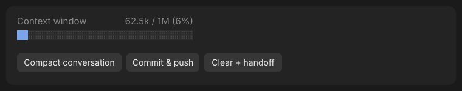

# manager

A Claude Code mod that adds a band above the prompt with a live context-window meter and five one-click buttons for keeping a long session under control.

## Preview

Desktop (Code tab):



Terminal:

```text
Context window                     62.5k / 1M (6%)
██░░░░░░░░░░░░░░░░░░░░░░░░░░░░░░░░░░░░░░

[ Compact ] [ Clear ] [ Commit & push ] [ Clear + handoff ]
```

The bar turns to the warning color once the context window is 80% full.

## Buttons

| Button | What it does |
| --- | --- |
| **Compact** | Runs `/compact`, then refreshes the meter. |
| **Clear** | Asks "Are you sure you want to clear the conversation?" with **Yes** and **No**. On **Yes** it runs `/clear` to start a fresh conversation, then refreshes the meter. |
| **Rewind** | Runs `/rewind` to open the rewind picker, so you can restore the conversation and code to an earlier point. |
| **Commit & push** | Asks Claude to commit every change in the repository with a descriptive message and push the current branch. Claude says so instead if there's no repository, nothing to commit, or no upstream. |
| **Clear + handoff** | Runs the `mattpocock-skills:handoff` skill to write a handoff document. When that turn ends, it runs `/clear` and starts a new turn that reads the handoff file and picks up where it left off. While this runs, the band shows "Writing handoff…" and then "Clearing and resuming from handoff…". |

The buttons only work between turns. While Claude is working they're dimmed and do nothing.

If the handoff turn is interrupted, or no handoff file was written, the conversation is kept and a toast says why.

## Requirements

- Claude Code with mods (plugin hooks) support, in the terminal or the desktop Code tab.
- **Clear + handoff** needs the `mattpocock-skills` plugin, which provides the `handoff` skill.

## Install

In a Claude Code terminal session:

```text
/plugin install manager --marketplace mlt-5/manager
```

Answer `y` to add the marketplace, then pick a scope. Installed at the user scope, it also loads in the desktop Code tab.

Without the CLI, add this to `~/.claude/settings.json` and start a new session:

```json
{
  "extraKnownMarketplaces": {
    "manager": { "source": { "source": "github", "repo": "mlt-5/manager" } }
  },
  "enabledPlugins": { "manager@manager": true }
}
```

To run it from a local folder while developing:

```bash
claude --plugin-dir "/path/to/manager"
```

## Files

```text
manager/
├── .claude-plugin/plugin.json   manifest
├── .claude-plugin/marketplace.json  makes the repo a marketplace
├── hooks/hooks.json             lists the hooks module
├── hooks/register.tsx           the mod: meter, buttons, handoff flow
├── types/index.d.ts             types for the mod's saved state (phase, contextFill)
├── tests/                       buttons.test.ts, context.test.ts
├── docs/preview.svg             the preview image above
└── tsconfig.json
```

`.claude-plugin/types/` holds editor types that Claude Code generates when it loads the mod. It recreates them, so there's no need to edit or commit them.

## Development

```bash
claude plugin validate .
```

```bash
claude plugin test .
```
